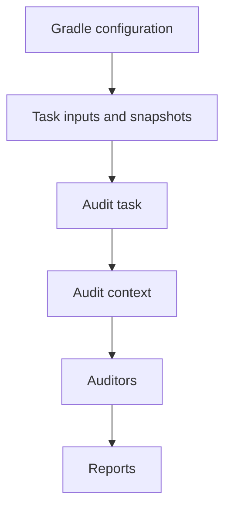

# Snapshot architecture

Gradle Lighthouse uses an input-driven design: project metadata is captured during Gradle configuration and passed to task execution as task inputs and serializable data. The intent is to keep auditor logic separate from direct Gradle project-model access.

## High-level flow

1. **Configuration:** plugin code wires selected project metadata and file inputs to tasks.
2. **Execution:** the audit task reconstructs an audit context from its inputs.
3. **Analysis:** enabled auditors inspect the context and return findings.
4. **Reporting:** report generators serialize the findings.

## Why this design is useful

Explicit task inputs make behavior easier to reason about and are a foundation for Gradle features such as Configuration Cache and isolated project configuration. They do not automatically guarantee compatibility. Those features must be verified with Gradle's diagnostics and automated tests for each release and project topology.

## Auditor contract

Auditors should consume the supplied audit context and avoid performing independent Gradle model access or hidden network calls. If a check needs new information, add it as an explicit input and document its source and limitations.

## Implementation details

The exact fields in `AuditContext`, the task inputs, and the aggregation mechanism evolve. Consult the source for the plugin version being changed. Do not assume that every dependency, source set, or project relationship is captured for every Android/KMP configuration.

See the [compatibility notes](../compatibility.md) and [testing guide](../developer/testing.md).
