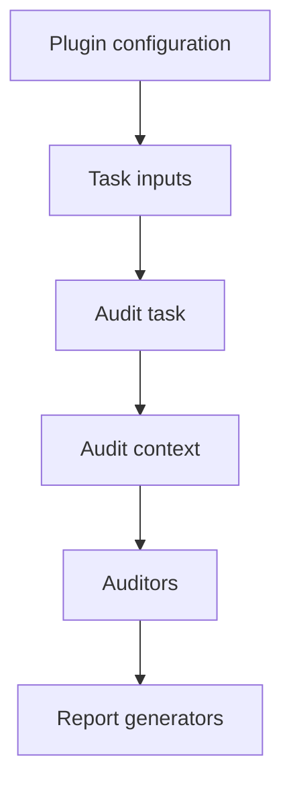

# Developer architecture guide

This document gives a high-level orientation to the plugin. The source code for the release being modified is authoritative when details differ.

## Design considerations

1. **Explicit inputs:** keep analysis inputs visible and testable.
2. **Small auditor logic:** avoid hidden state and make checks reproducible.
3. **Lazy Gradle integration:** use Gradle providers and task properties appropriately.
4. **Portable reports:** keep report assets and dependencies deliberate.

## Audit flow

At a high level, plugin configuration wires project metadata and file inputs to task properties. The audit task builds an audit context, invokes enabled auditors, and passes findings to report generators.

Exact data captured, task boundaries, and report behavior are implementation details. Do not assume every Gradle/AGP/KMP model is represented.

## Aggregation

The aggregate task consumes module reports and constructs a project-level view from the data it can access. Its compatibility with Gradle features must be established by tests for the relevant versions and topologies.

## Extension points

- **Auditors:** implement the auditor contract and register the check.
- **Reports:** add a report generator and tests for output correctness.
- **Remediation:** changes to the fix task must be deterministic, reviewable, and covered by fixtures. Do not describe the current implementation as AI/LLM-powered.

## Performance and correctness

Avoid repeated file traversal where inputs can be captured once. Prefer explicit, reproducible inputs. Measure performance claims and document the environment rather than relying on estimates.
